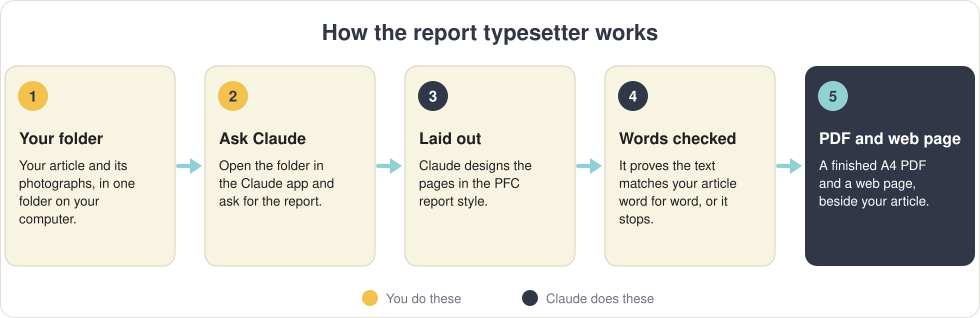
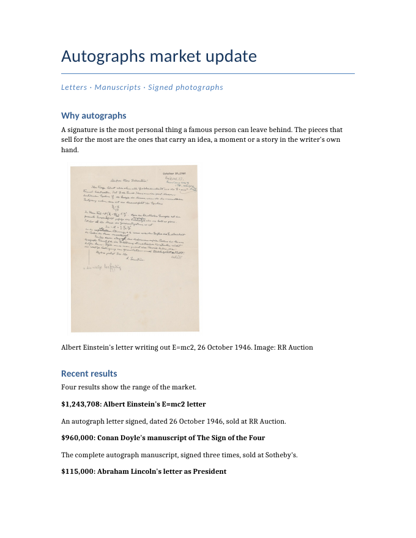
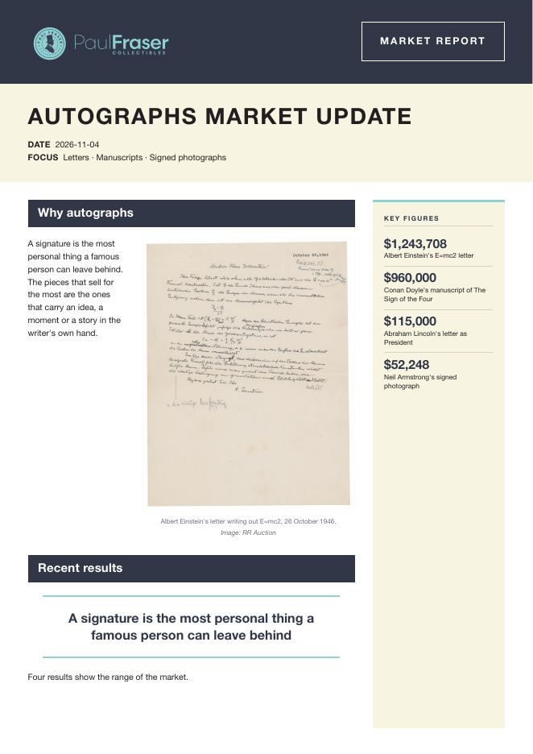
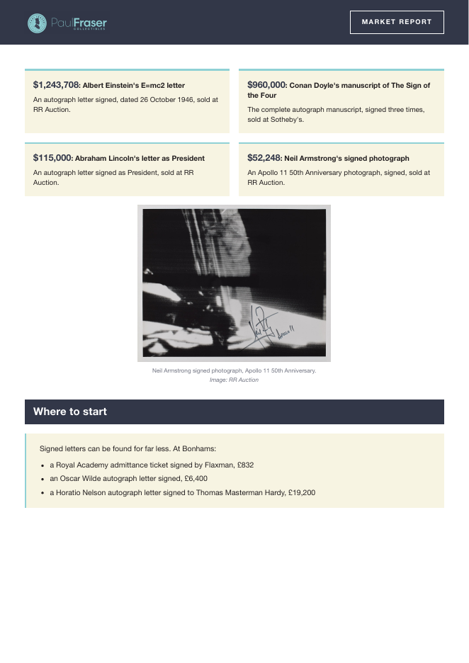
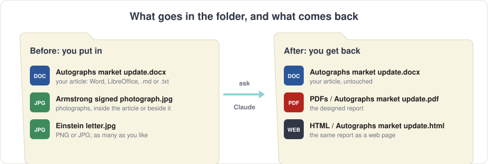
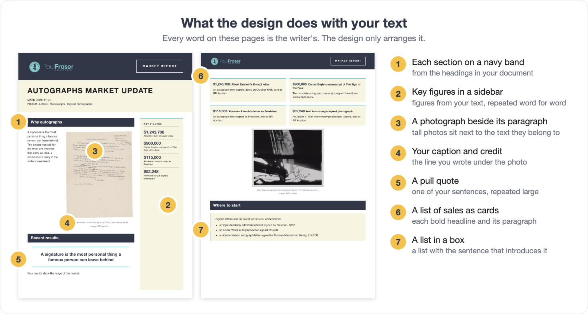

# Report typesetter

**Give it your article and your photographs. Get back a designed PDF report, and a web page, in the Paul Fraser Collectibles style.**

> [!NOTE]
> **Your words are never changed.** Before it makes the PDF, it checks every word and every figure against your article. If a single one is different, it stops and makes nothing. Typos included: what you wrote is what gets printed.

This skill is for any article or report you want laid out in the PFC design. For a market report, which comes in both the Paul Fraser Collectibles and Collecting Daily editions, use [market-report-layout](https://github.com/CollectingDaily/claude-market-report-layout) instead.

---

## What goes in, what comes out

<table>
<tr>
<td width="33%" align="center"><strong>Your article</strong> written in Word</td>
<td width="33%" align="center"><strong>Page 1 of the PDF</strong></td>
<td width="33%" align="center"><strong>Page 2 of the PDF</strong></td>
</tr>
<tr>
<td></td>
<td></td>
<td></td>
</tr>
</table>

---

## Before you start: what you need

- [ ] **The Claude app on your computer**, with its **Code** tab. The Code tab needs a paid Claude plan (Pro, Max, Team or Enterprise). Claude in a web browser can't do this, because the skill works with files on your computer. [Download the app](https://code.claude.com/docs/en/desktop-quickstart).
- [ ] **Python 3.** On Windows: open the **Microsoft Store**, search for **Python Install Manager** and click **Install**. On a Mac it's usually there already; if your Mac asks to install "command line developer tools", click **Install**.
- [ ] **Google Chrome or Microsoft Edge.** It's used to draw the pages. Every Windows PC has Edge.

Built and tested on a Mac, and written to run on Windows too.

## Installing it (once)

1. **Get access.** The skill lives on the Collecting Daily GitHub, which is private. Ask for your GitHub account to be added.
2. **Download it.** On the [skill's GitHub page](https://github.com/CollectingDaily/claude-report-typesetter), click the green **Code** button, then **Download ZIP**.
3. **Install it.** Open the Claude app, click **Code**, choose **Local** and any folder, drag the ZIP into the message box and type: *Install this skill as a personal skill.* Click **Allow** when asked.
4. **Restart.** Close the Claude app and open it again. Type **/** in the message box and look for **report-typesetter** in the list. If it's there, you're ready.

---

## Making a report, step by step

### 1. Write your article

Write it as you normally would, in **Word, LibreOffice, Google Docs** or **Obsidian**. A few habits make the design come out best:

| Do this in your document | And you get |
| --- | --- |
| Put the **title on the first line** | The big title on page 1 |
| Optional: a short **focus line** under the title, like *Letters · Manuscripts · Signed photographs* | The FOCUS line under the title |
| Use **Heading 1** from the styles menu for each section | Each section on a navy band |
| For a list of sales, write each one as a **bold headline** and then a short paragraph | Cards, two to a row |
| Number short points yourself (*1. …*, *2. …*) | Panels, with the number set large |
| Put each photograph where it belongs, and its **caption on the line directly under it**, with the credit: *Neil Armstrong signed photograph. Image: RR Auction* | The photograph with your caption beneath it |

A photograph with no line under it gets no caption: Claude never writes one.

### 2. Save it and make a folder

Save the article as **.docx** (Word), **.odt** (LibreOffice), **.md** (Obsidian) or **.txt**. From Google Docs: **File → Download → Microsoft Word (.docx)**.

Put it in a folder of its own. Photographs can be **inside the document** or **beside it in the folder** as **PNG** or **JPG** files. Give loose photographs clear names, like *Armstrong signed photograph.jpg*, so Claude knows where each belongs. Photos straight from an iPhone (*.heic*) only work on a Mac, so save them as JPG first.

**Please don't send a PDF or a Pages file**: Claude needs the words themselves.

### 3. Open the folder in Claude

In the Claude app, click **Code**, choose **Local**, click **Select folder** and pick your report's folder.

### 4. Ask for the report

Type:

> */report-typesetter Make the report from the article and images in this folder.*

Click **Allow** whenever Claude asks permission to run the skill.

### 5. Collect your files

Claude adds two folders next to your article: **PDFs**, with the finished report, and **HTML**, with the same report as a web page. Your article itself is never touched.

Claude also tells you what it decided (where each photograph went, which sentences became pull quotes) and lists **anything in your text worth a second look** before it goes out:

- a placeholder you forgot, like *TEXT TO GO HERE*;
- a sentence that mentions a picture you didn't include, like *"(above)"*;
- a figure that says one thing in the text and another in a chart.

It never fixes these itself. Change your document, save it, and ask again.

---

## What the design does with your text

Everything here is **your own words, rearranged**. Key figures and pull quotes repeat your sentences and figures exactly: Claude can't invent one, and the check refuses any that isn't word for word in your article. An article without a list of sales simply gets no cards. Nothing is ever left empty.

Each report also gets the PFC contact box after the last section, and the standard line at the foot of the last page: *"This document is non-independent investment research and a marketing communication."*

---

## Steering the design

Claude chooses the boxes, pull quotes and key figures itself. To steer it, say so in the same message, for example:

- *put the bar chart after the paragraph about the coin index*
- *put the golden rules in a box*
- *use "A signature is the most personal thing a famous person can leave behind" as a pull quote*
- *leave out the key figures*
- *don't add the contact box, the article already ends with our details*

## Changing the article afterwards

Edit your document, save it, and ask: *The article has changed, please make the report again.* The earlier version is kept in the workings folder, never deleted.

---

## Questions

**Will it correct my spelling or improve my writing?**
No. It only designs. Fix anything in your document first.

**It stopped and said the text differs. What happened?**
Something on the page didn't match your article word for word, so it refused rather than print it. Claude says what differed. Usually it fixes its own layout and tries again; if it asks you something, answer and it carries on.

**Can I send a PDF?**
No. Send the Word, LibreOffice or text file the PDF came from.

**Where are my files?**
In the **PDFs** and **HTML** folders, inside the folder you chose. There's also a **WORKINGS** folder with Claude's copies and page previews: you can ignore it.

**I'd rather lay the report out myself.**
Use the LibreOffice template in [`template/`](template): double-click *PFC report template.ott*, paste your article over the sample text, use the **Title** and **Heading** styles, add photographs with **Insert → Image**, and save with **File → Export As → Export as PDF**. It has the same header, title band and text styles, but not the cards, panels, key figures or web page.

---

<strong>For the technically minded</strong>

`SKILL.md` is the full procedure Claude follows, including the rules for every design element and the visual check of every page before anything is delivered.

| Path | What it does |
| --- | --- |
| `scripts/ingest.py` | Copies the article (untouched) and the images into a workings folder, and writes a working file for the layout. Reads .odt, .docx, .md and .txt directly; older formats through LibreOffice or macOS `textutil`. |
| `scripts/build.py` | Lays the pages out in headless Chrome or Edge, checks nothing is clipped, runs the text check, writes the PDF, the HTML and a preview of every page. |
| `scripts/textcheck.py` | Proves the words and figures in the output are the article's, in its order, and that every pull quote and key figure is word for word from it. |
| `scripts/odt.py` | Reads LibreOffice files directly, keeping headings, lists, links, tables, footnotes and images. |
| `scripts/dmd.py` | The markdown the layout is written in, including the marks for cards, panels, boxes and pull quotes. |
| `scripts/system.py` | What differs between Windows and macOS. |
| `assets/` | The PFC stylesheet, the additions for this skill, and the logo. |
| `template/` | The LibreOffice template, and `make_template.py`, which rebuilds it. |

Python 3 standard library only. Optional: poppler (`pdftoppm`) renders the page previews from the PDF itself; without it they are Chrome screenshots.

